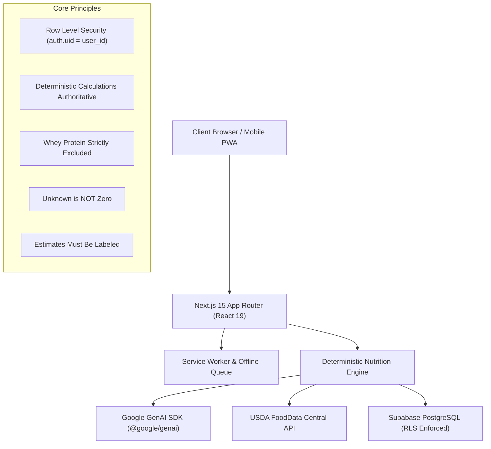

# Personal AI Nutrition Platform

> A production-grade, full-stack, AI-powered personal nutrition and fitness tracking progressive web application (PWA) tailored for **Sarveswar** with multi-user-safe architecture.

---

> [!WARNING] **Gemini API Privacy Notice & Sensitive Health Data**
> Google's free-tier Gemini API terms state that submitted content and prompts may be reviewed by human reviewers and used to improve Google products and machine learning technologies. For logging sensitive personal health records, biometrics, or private dietary data, **we strongly recommend using a paid-tier Google Cloud API key with data-logging opt-outs enabled** or reviewing Google's current API Data Governance documentation before production deployment.

---

## 1. Architectural Overview



### Technology Stack
* **Frontend / Full Stack**: Next.js 15.5 (App Router, Server Actions, Route Handlers), React 19, TypeScript (strict mode).
* **Styling & UI**: Tailwind CSS, Lucide icons, Recharts interactive data visualization.
* **Database & Auth**: Supabase PostgreSQL with strict Row Level Security (RLS) on every user table (`supabase/migrations/20261029000000_init_schema.sql`).
* **AI & LLM**: Google Gemini via official `@google/genai` SDK wrapped in a resilient `LLMClient` with exponential backoff retries, timeouts, and structured JSON schemas.
* **Nutrition Data**: USDA FoodData Central API cached in PostgreSQL, integrated with scientific Indian food composition tables.
* **PWA & Offline**: Web App Manifest, Service Worker (`sw.js`) with cache strategies, and an atomic offline mutation queue using client idempotency keys.
* **Testing & Quality**: Vitest (54 unit tests), ESLint flat configuration, strict TypeScript type checking.

---

## 2. Hard Operating Principles

1. **Deterministic Core Over LLM**: The LLM interprets conversational user inputs, categorizes meals, and generates conversational suggestions. **All arithmetic, macro calorie totals (4-4-9), rolling averages, BMI, BMR/TDEE calculations, and database mutations are executed deterministically in backend code.**
2. **Unknown Is Not Zero**: Missing micronutrients or fiber values are explicitly stored and displayed as `unknown` / `null`, never assumed to be zero.
3. **Estimates Must Be Labeled**: Any nutritional values estimated from portion descriptions or unverified sources are explicitly badged as `"estimated"`.
4. **Sarveswar's Dietary Constraints**:
   - **Whey protein is strictly excluded** from all automated meal recommendations and recipes.
   - Dinner completion cutoff is set to **7:00 PM** (`Asia/Kolkata` time).
   - Practical PG-friendly and restaurant-accessible meal recommendations are prioritized.
   - Age is verified during onboarding and never fabricated or assumed.
5. **Client Idempotency Keys**: All mutations and offline sync operations carry unique idempotency keys (`offline-...` or `log-...`) preventing duplicate records from rapid clicks or network retries.

---

## 3. Sarveswar Profile & Default Targets

| Parameter | Configuration |
|---|---|
| **Name** | Sarveswar |
| **Sex / Height / Weight** | Male / 175.5 cm / 75.0 kg |
| **Activity Level** | Regular gym workouts (1.55 PAL multiplier) |
| **Timezone** | `Asia/Kolkata` (Strict day boundary calculation) |
| **Dinner Cutoff** | 7:00 PM |
| **Daily Calorie Target** | 2,400 kcal |
| **Daily Protein Target** | 150 g |
| **Daily Carbohydrates** | 290 g |
| **Daily Fats** | 70 g |
| **Daily Dietary Fibre** | 35 g |
| **Daily Water Target** | 3,000 ml |

*Mifflin-St Jeor BMR (1,691 kcal) and TDEE (2,621 kcal) are displayed side-by-side with user manual targets and never overwrite manual targets without explicit user confirmation.*

---

## 4. Local Development Setup

### 4.1 Prerequisites
- Node.js 20+ (v23 tested)
- `pnpm` 10+ (`corepack enable pnpm`)

### 4.2 Installation
```bash
# Clone and enter workspace
cd C:\SARVESWAR\Sarveswar_Health_App

# Install dependencies
pnpm install

# Setup environment variables
cp .env.example .env.local
```

### 4.3 Configure `.env.local`
Update placeholders with your API credentials:
```env
NEXT_PUBLIC_SUPABASE_URL=https://your-project.supabase.co
NEXT_PUBLIC_SUPABASE_ANON_KEY=your-anon-key
SUPABASE_SERVICE_ROLE_KEY=your-service-role-key
GEMINI_API_KEY=your-gemini-key
GEMINI_MODEL_FAST=gemini-2.5-flash
GEMINI_MODEL_PRO=gemini-2.5-pro
USDA_API_KEY=your-usda-key
APP_TIMEZONE=Asia/Kolkata
```

### 4.4 Run Development Server
```bash
pnpm run dev
```
Open [http://localhost:3000](http://localhost:3000) in your browser.

---

## 5. Verification & Test Suite

Run the full verification suite anytime:

```bash
# 1. Run 54 unit tests
pnpm test

# 2. Strict TypeScript type check
pnpm run type-check

# 3. Code linting
pnpm run lint

# 4. Production build
pnpm run build
```

---

## 6. Android PWA Installation Checklist

1. Open Google Chrome on your Android mobile device.
2. Navigate to your deployed production URL (e.g. `https://sarveswar-health-app.vercel.app`).
3. An **"Install Health Tracker"** pill will appear automatically at the bottom right.
4. Alternatively, tap the Chrome three-dot menu `⋮` and select **"Add to Home screen"** or **"Install app"**.
5. The application icon will appear on your device launcher, opening in full-screen standalone mode with offline queue support.

---

## 7. Data Sources, Licensing & Quotas

* **USDA FoodData Central API**: Public domain (CC0 1.0 Universal). Standard rate limit is 1,000 requests per hour. Lookups are cached in PostgreSQL.
* **ICMR-NIN Indian Food Composition Tables (IFCT)**: Copyright-protected by the Indian Council of Medical Research. Not bundled in bulk; verified nutritional profiles for staple items (paneer, roti, dal, chicken biryani) are calibrated using verified compositional references.
* **Open Food Facts**: Open Database License (ODbL). Attributed and cached per item.

---

## 8. Deployment Guides

For complete end-to-end cloud deployment instructions for **Supabase**, **Vercel**, and **Google Cloud Run (Docker)**, see:
👉 [Production Deployment Guide (`docs/deployment.md`)](file:///C:/SARVESWAR/Sarveswar_Health_App/docs/deployment.md)
